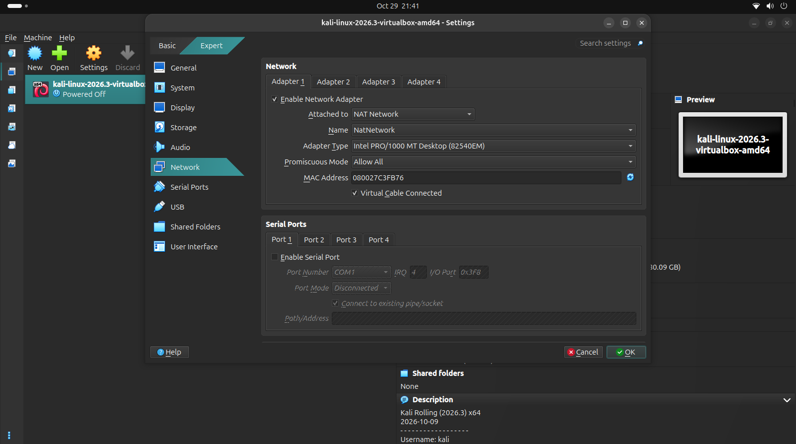
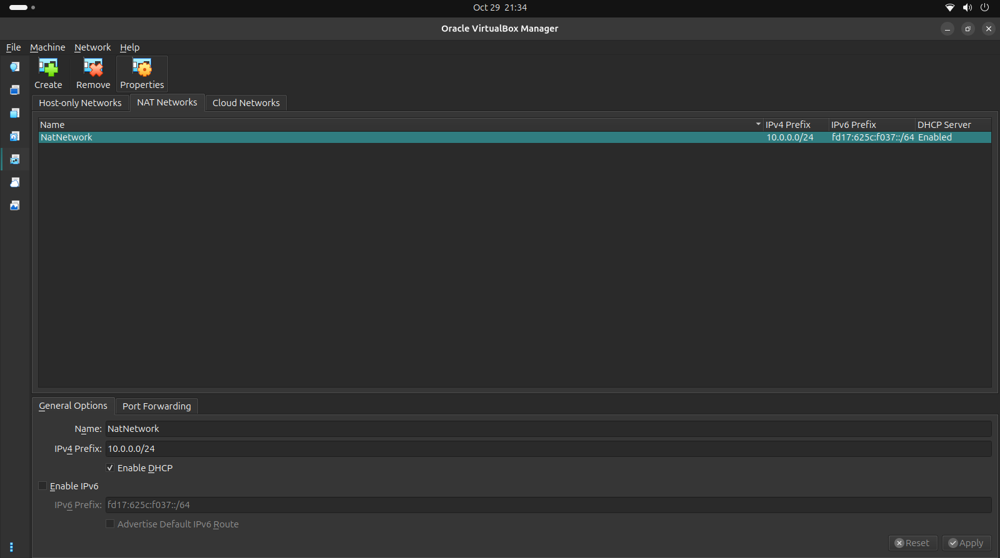
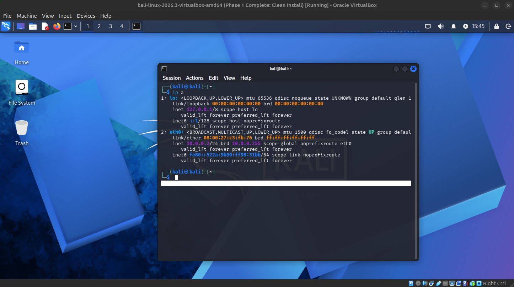
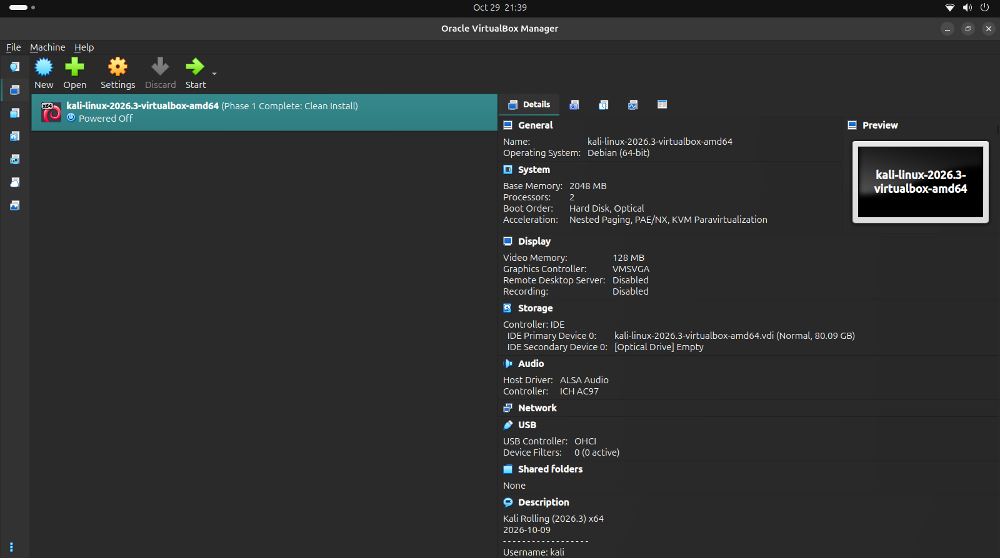
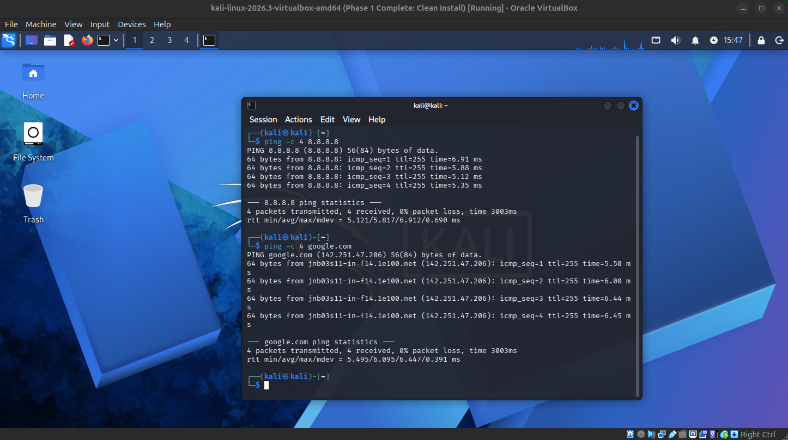
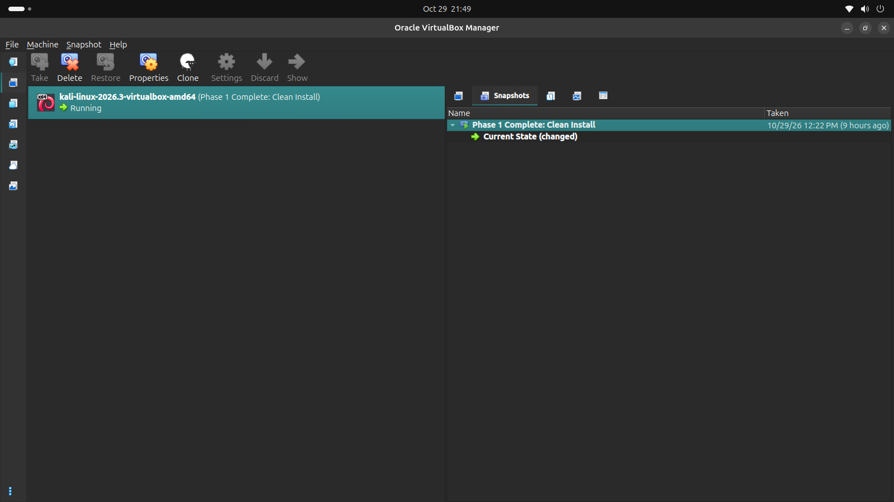

# Cybersecurity Lab Environment Setup

**Program:** Cybersecurity at Networkwalks | **Week:** 01 | **Project:** Pentesting Lab Setup

---

## Project Overview
This project documents the setup of an isolated virtual laboratory using VirtualBox and Kali Linux. The goal was to create a safe, private environment for future network scanning and security testing.

## Lab Configuration
*   **Host OS:** Ubuntu Linux
*   **Hypervisor:** VirtualBox
*   **Attacker VM:** Kali Linux 2026.3
*   **Network:** NAT Network (10.0.0.0/24)
*   **Kali IP:** 10.0.0.2

---

## Setup Procedure & Evidence

### 1. Virtual Machine Configuration
The Kali Linux VM was imported and configured with 2048 MB of RAM. Adapter 1 was attached to the custom `NatNetwork`. Bidirectional clipboard and shared folders were enabled.

### 2. NAT Network Configuration
A dedicated NAT Network was created to allow future target machines to communicate with the Kali VM.

### 3. IP Address & Architecture
The Kali VM was assigned a static IP address of `10.0.0.2/24` with the gateway set to `10.0.0.1`.

*Main VirtualBox architecture:*

### 4. Connectivity Verification
Internet connectivity and DNS resolution were successfully verified using ping commands to Google DNS and google.com.

### 5. Snapshot Creation
A clean baseline snapshot was taken to ensure the lab can be easily restored if future exercises break the VM.

---

## Problems Encountered & Solutions

**1. GRUB Rescue Error on Boot**
*   **Issue:** The VM booted into a `grub rescue>` prompt.
*   **Solution:** Changed the VirtualBox Storage Controller from SATA to **IDE** and disabled EFI in the system settings. The VM booted successfully.

**2. NetworkManager Timeout**
*   **Issue:** Encountered a "No available address, timeout" error when applying the static IP.
*   **Solution:** Disabled the Duplicate Address Detection (DAD) timeout in Kali using:
    `sudo nmcli connection modify "Wired connection 1" ipv4.dad-timeout 0`
    Then restarted the network connection.

---

## Author
**Khulekani Mtshali**

LinkedIn: [https://www.linkedin.com/in/khulekani-mtshali/](https://www.linkedin.com/in/khulekani-mtshali/)
